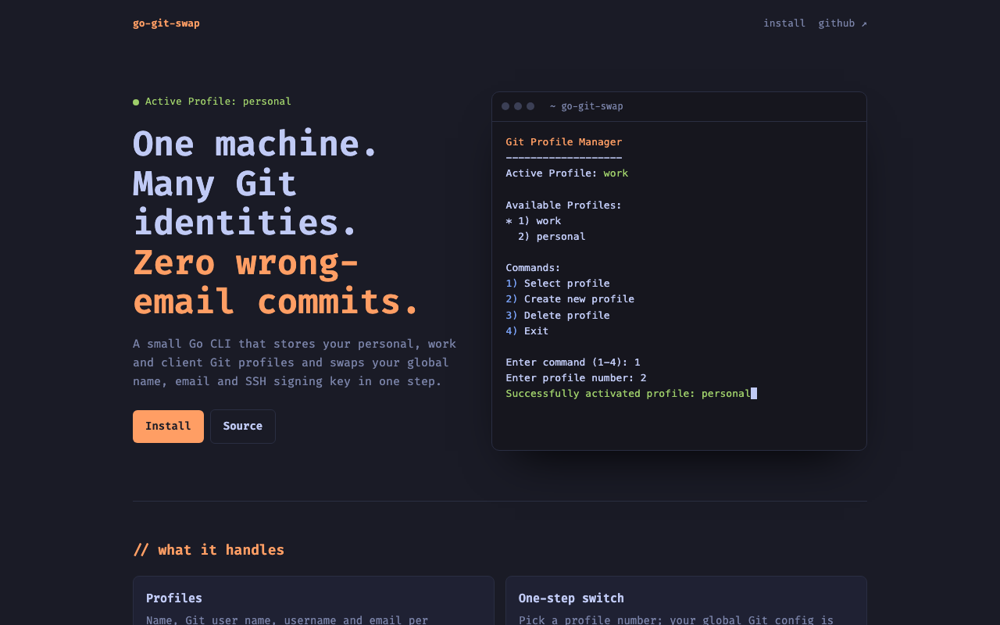
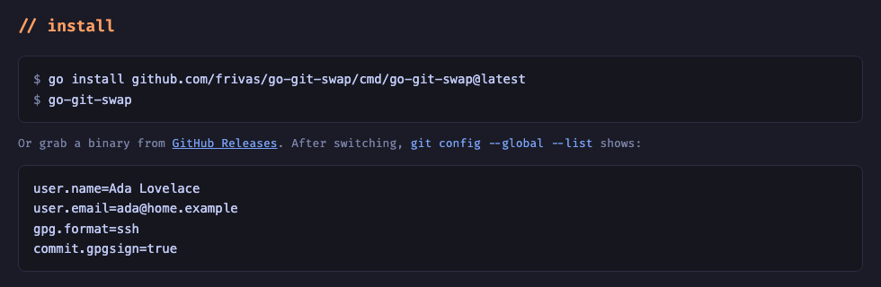

<div align="center">

# go-git-swap

**One machine. Many Git identities. Zero wrong-email commits.**

A small Go CLI that keeps your personal, work and client Git profiles and switches your global name, email and SSH signing key in one step.

[](https://github.com/frivas/go-git-swap/actions/workflows/go.yml)
[](https://github.com/frivas/go-git-swap/releases/latest)
[](go.mod)
[](https://goreportcard.com/report/github.com/frivas/go-git-swap)
[](LICENSE)

[Website](https://gitswap.probablysmart.com) · [Install](#install) · [Usage](#usage) · [Releases](https://github.com/frivas/go-git-swap/releases)

<br>

<a href="https://gitswap.probablysmart.com"></a>

</div>

## Why

You commit to work repos, personal projects and client code from the same laptop. Sooner or later a commit goes out with the wrong email, or signed with the wrong key. go-git-swap stores each identity once and applies the whole set (name, email, signing key and signing settings) together, so nothing from the previous profile is left behind.

## Features

|  |  |
| --- | --- |
| **Profiles** | Name, Git user name, username and email per identity, stored in `~/.go-git-swap.json` (`0600`). |
| **One-step switch** | Pick a profile number and your global Git config is rewritten for you. |
| **SSH commit signing** | Attach a `.pub` key and it sets `gpg.format=ssh`, `user.signingkey` and `commit.gpgsign`, and adds you to your allowed signers file so `git log --show-signature` verifies. |
| **No leaks between profiles** | A profile without a key turns signing off, so you never sign with another identity's key. Covered by a test that switches between every pair of profiles. |
| **Validation** | Rejects bad profile names, malformed emails and private keys passed as public keys. |
| **Cross-platform** | Linux (amd64, arm64), macOS (Apple Silicon), Windows (amd64, arm64). |

## Install



**With Go** (1.27+):

```bash
go install github.com/frivas/go-git-swap/cmd/go-git-swap@latest
```

**Prebuilt binaries:** download yours from the [latest release](https://github.com/frivas/go-git-swap/releases/latest).

| Platform | File |
| --- | --- |
| Linux x86-64 | `go-git-swap-linux-amd64` |
| Linux ARM64 | `go-git-swap-linux-arm64` |
| macOS Apple Silicon | `go-git-swap-darwin-arm64` |
| Windows x86-64 | `go-git-swap-windows-amd64.exe` |
| Windows ARM64 | `go-git-swap-windows-arm64.exe` |

Verify the download against `SHA256SUMS` from the same release:

```bash
shasum -a 256 -c SHA256SUMS --ignore-missing
```

On macOS and Linux, make it executable and put it on your `PATH`:

```bash
chmod +x go-git-swap-* && mv go-git-swap-* /usr/local/bin/go-git-swap
```

## Usage

```bash
go-git-swap
```

```text
Git Profile Manager
-------------------
Active Profile: work

Available Profiles:
  1) personal
* 2) work

Commands:
1) Select profile
2) Create new profile
3) Delete profile
4) Exit
```

- **Create** (`2`): enter a profile name, full name, username and email, and optionally the path to an SSH public key such as `~/.ssh/id_ed25519.pub`.
- **Switch** (`1`): pick a profile number. The change applies to every repository that has no identity of its own.
- **Delete** (`3`): remove a profile. It asks for confirmation if it's the active one.

`go-git-swap --version` prints the installed version.

### What a switch changes

| Git setting | Profile with a signing key | Profile without a key |
| --- | --- | --- |
| `user.name`, `user.email` | set | set |
| `user.signingkey` | path to your `.pub` | removed |
| `commit.gpgsign` | `true` | removed |
| `gpg.format` | `ssh` | unchanged |
| `gpg.ssh.allowedSignersFile` | kept if already set, otherwise `~/.ssh/allowed_signers` | unchanged |

Your allowed signers file is only ever appended to; existing entries are kept.

> [!NOTE]
> go-git-swap writes your **global** config. Settings in a repository's own `.git/config`, or from an `includeIf` block, take precedence over it. If you always keep work and personal code in separate folders, `includeIf "gitdir:~/work/"` may be all you need.

## Development

```bash
git clone https://github.com/frivas/go-git-swap.git
cd go-git-swap

make build       # bin/go-git-swap
make test        # go test -race ./...
make lint        # golangci-lint
make vuln        # govulncheck
make checksums   # all release binaries + SHA256SUMS
```

Tests never touch your real Git config: each one runs `git` and `ssh-keygen` against a temporary home directory.

```text
cmd/go-git-swap/     CLI entry point and menu
internal/config/     profile store (~/.go-git-swap.json)
internal/git/        git config, signing keys, allowed signers
internal/model/      data types
internal/validator/  input validation
```

Releases are automatic: CI tests on Linux, macOS and Windows, and pushing a `v*` tag publishes the binaries.

## Roadmap

- [ ] Non-interactive `go-git-swap use <profile>`
- [ ] Modern TUI with [Bubble Tea](https://github.com/charmbracelet/bubbletea)
- [ ] Profile templates
- [ ] Configuration backup

## Contributing

Issues and pull requests are welcome. For bigger changes, please [open an issue](https://github.com/frivas/go-git-swap/issues) first. Run `gofmt`, add tests for new behaviour, and make sure `make test lint` passes.

## License

[MIT](LICENSE) © Francisco Rivas
